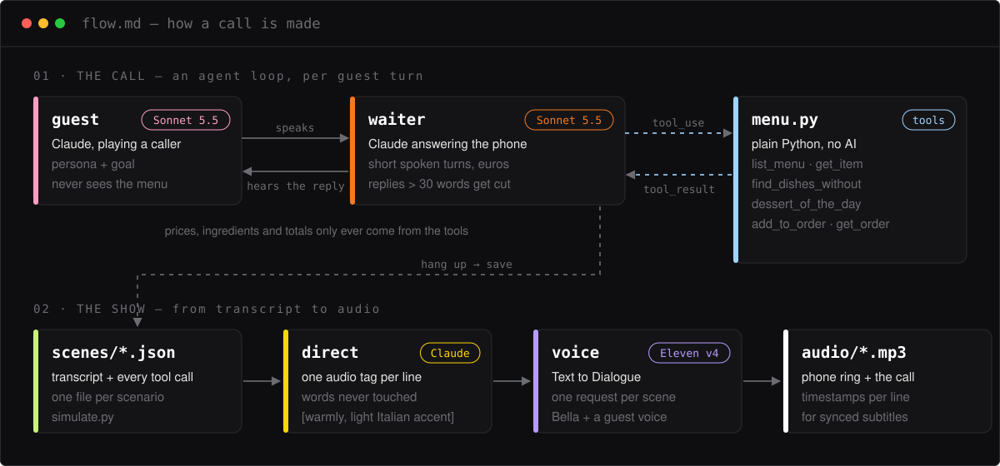

# Gino Pizza, good evening!

**An AI waiter that takes phone orders from a real pizzeria menu, and a pipeline that turns each call into expressive audio.**

<sub>13 November 2026 · an experiment to try what just shipped: Claude Sonnet 5.5 for the agents, Eleven v4 in ElevenLabs Text to Dialogue for the voices.</sub>


## What it is

Two Claude agents talk on the phone. One plays a **guest** with a persona and a goal, and has never seen the menu. The other is the **waiter**: it answers in short spoken turns and calls plain Python tools for every price, ingredient and total, so it can't make them up.

Once a call is over, a second pass adds one Eleven v4 audio tag per line (`[reassuringly, light Italian accent]`). ElevenLabs Text to Dialogue then voices the whole conversation in one request, with timestamps for every line.

## What we're testing

| New | How it's used here |
|---|---|
| **Claude Sonnet 5.5** | Both agents, plus the director pass. The waiter runs a hand-written tool loop, so every call is traced. |
| **Eleven v4** (`eleven_v4_turbo`) | Voices both speakers. Audio tags in brackets set the tone of each line, and the waiter keeps a light Italian accent. |
| **Text to Dialogue with timestamps** | One request per call returns the mp3 plus the start and end of each line, ready for synced subtitles. |
| **Sound effects** | Generates the phone ring that plays before each call. |

## The agentic flow



## Listen

Three callers, three goals. The mp3 files are committed, so you don't need to generate anything to hear them.

| Call | The guest wants… | Voices | Order | Audio |
|---|---|---|---|---|
| **Is it really vegetarian?** | a pizza with no animal rennet | Bella + Sarah | Margherita, sparkling water · 16.50 € | [vegetarian.mp3](audio/vegetarian.mp3) · 39 s |
| **What's the dessert of the day?** | the dessert first, then a pizza | Bella + Roger | 2 pistachio tiramisus, Goat Cheese & Honey · 23 € | [dessert.mp3](audio/dessert.mp3) · 56 s |
| **Dinner for four on a budget** | under 50 €, no mushrooms for the kids | Bella + George | Margherita, Pepperoni, Calzone, 4 soft drinks · 48 € | [family.mp3](audio/family.mp3) · 66 s |

Each call plays after [ring.mp3](audio/ring.mp3). The full transcripts, with every tool call, are in [`scenes/`](scenes).

## Run it

```bash
python3 -m venv .venv && source .venv/bin/activate
pip install -r requirements.txt
cp .env.example .env        # add your ElevenLabs and Anthropic keys
pytest -q                   # offline tests, free
```

Every paid step does a dry run first and only spends credits with `--confirm`:

```bash
python scripts/simulate.py --confirm   # 1. the calls, text only (Claude, a few cents each)
python scripts/direct.py --confirm     # 2. one audio tag per line, words untouched
python scripts/voice.py --confirm      # 3. Text to Dialogue + phone ring (about $0.13 for all three)
```

Calls whose text, voices and model haven't changed are never regenerated. To pick other voices, see `scripts/find_voices.py` and `scripts/probe_dialogue.py`.

## Inside

```
agent/menu.py       the menu and the 6 tools. No AI: prices and totals always come from here
agent/waiter.py     Claude on the phone, tool loop, long replies get a shorter take
agent/guest.py      Claude as the caller, hears only what the waiter says
data/menu.json      faithful transcription of data/menu.pdf, with kitchen notes (rennet, meat)
data/scenarios.json the three callers and what they want
data/voices.json    model, waiter voice and accent tag, one voice per guest
scripts/            simulate → direct → voice, plus the voice probes
scenes/  audio/     the generated calls, committed
```

<sub>Built with Claude Code · Damien Chau · [Portfolio](https://portfolio-nine-rosy-69.vercel.app)</sub>
